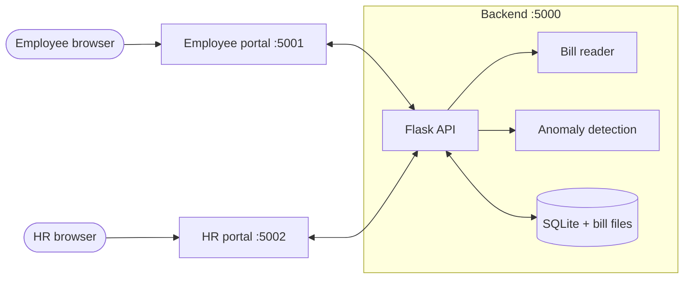
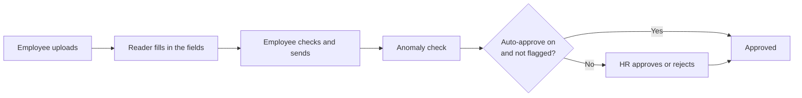

# Fuel Reimbursement System: Design Document

Track: `[TRACK NAME: replace this line with your track]`
Date: 12 October 2026
Code: the `Task` folder (Windows) and `Task-Docker` (Docker). The block diagram slide is in `Reimbursement_Block_Diagram.pptx`.

---

## 1. Overview

### The problem

People who drive for work claim back their fuel, car repair and maintenance costs. Right now that means collecting bills, typing the bill number, date and amount into a form, and waiting for HR to check each one by hand. The typing is slow, mistakes creep in, HR has nothing to help them notice a strange claim, and the employee never really knows where their bill is.

### What we built

Two small websites that share one backend:

- **Employee portal.** The employee uploads several bills at once. Each bill gets its own row, and the system fills in the bill number, date, amount and a guess at the type (fuel, repair, maintenance). The employee checks the row, fixes anything wrong and clicks **Send to HR**.
- **HR portal.** HR sees the bills that were sent and approves or rejects each one. If an amount looks unusual for that employee, the row turns red and says why. Every decision stays in a history list. There is also a switch to auto-approve bills that are not flagged.

When HR decides, the employee's portal shows the result within a few seconds.

### Track

We chose the **`[TRACK NAME: replace this line with your track]`** track. (Add one or two lines here on why the project fits it, in your own words.)

### What it is not

It does not pay anyone, it has no email notifications, and it is built for one company with a handful of users. The logins are demo accounts.

---

## 2. Architecture

Everything runs from one Python program that starts three small web servers: the backend API on port 5000, the Employee portal on 5001 and the HR portal on 5002. Both portals talk to the same API, and the API holds all the data and rules. The portals only show things and collect input.

<!-- diagram: architecture -->

*Figure 1: The pieces and how they connect.*

### How a bill moves through it

<!-- diagram: flow -->

*Figure 2: The path of one bill.*

1. The employee uploads photos or PDFs. The backend saves them and creates one row per bill with the status *processing*.
2. A background worker reads each file and fills in the fields. The row becomes a *draft*.
3. The employee corrects anything wrong and clicks Send. The backend checks that nothing is missing, that the date is not in the future, and that the same bill was not already sent.
4. The anomaly check runs straight away and the result is saved with the bill.
5. If HR has auto-approve switched on and the bill was not flagged, it is approved on the spot. Otherwise it waits for HR as *pending*.
6. HR approves, or rejects with a reason. The employee sees the new status.

The accompanying slide, `Reimbursement_Block_Diagram.pptx`, shows the same thing as one picture. It replaces our first hand-drawn plan, which had a separate model for each bill type and a separate fraud model. We simplified that to one bill reader and one anomaly check, because a single reader can handle every bill type, and there is no labelled fraud data to train a fraud classifier on.

<!-- slide-preview -->

### Data

The data lives in a single SQLite file with four tables: users, login sessions, settings, and bills. A bill row holds the uploaded file name, the four fields (number, date, amount, type), its status (*processing*, *draft*, *pending*, *approved*, *rejected*), HR's comment and decision time, whether it was approved by a person or automatically, and the anomaly result with its reasons. Uploaded files are kept in a folder next to the database.

---

## 3. Setup and deployment

### On Windows

You need Python 3.10 or newer. For reading bills offline, install Tesseract OCR from https://github.com/UB-Mannheim/tesseract/wiki. The app checks the usual install folders; if yours is somewhere else, put its path in `backend\.env`:

```
TESSERACT_CMD=C:\path\to\tesseract.exe
```

Then double-click `start.bat`. The first run creates a `.venv` folder and installs the packages, after which both portals open in the browser. The same thing by hand:

```
python -m venv .venv
.venv\Scripts\python -m pip install -r requirements.txt
.venv\Scripts\python run.py
```

### With Docker

The Docker image already contains Tesseract, so there is nothing else to install. From the `Task-Docker` folder:

```
docker compose up --build
```

The data is kept in a Docker volume, so it survives restarts. `docker compose down -v` wipes it.

Keep the ports at 5000, 5001 and 5002 on both sides. The portals look for the API on port 5000 of the same machine, and the API only accepts calls from the two portal ports.

### Addresses and logins

| | Address | Login |
|---|---|---|
| Employee portal | http://localhost:5001 | `amit`, `priya` or `rahul`, password `emp123` |
| HR portal | http://localhost:5002 | `hr`, password `hr123` |

### Settings

All optional. On Windows they go in `backend\.env`; for Docker, in a `.env` file next to `docker-compose.yml`.

- `ANTHROPIC_API_KEY`: reads bills with Claude instead of Tesseract. It is more accurate but needs internet and costs a little per bill.
- `SAMPLE_HISTORY=0`: removes the sample bills described in section 4.

### Quick check that it works

Open `http://localhost:5000/api/health`; it should answer `ok`. Then log in as `amit`, upload a bill, send it, and approve it from the HR portal. Sending a bill of about ₹9,000 should make a red row appear in HR.

### Resetting

Stop the app and delete the `backend\data` folder (Windows) or run `docker compose down -v` (Docker).

### Before real use

Treat this as a working prototype. For real use you would replace the demo accounts, serve it over HTTPS, use a proper production web server and a bigger database, and add session expiry.

---

## 4. How the code works

**`run.py`** starts the three servers and prints the addresses.

**`backend/app.py`** is the API. It creates the database on start-up, handles login (passwords are hashed, and each login gets a random token), and has the routes for employees (upload, edit, delete, send) and HR (list bills, approve or reject, auto-approve switch). Employees can only reach their own bills; HR can only see bills that were actually sent. The send route does the most work: it validates the bill, runs the anomaly check and applies the auto-approve rule in one go. When HR decides a bill the update only goes through if the bill is still pending, so two people cannot decide the same bill twice.

**`backend/extractor.py`** reads the bills. If an API key is set it asks Claude, which returns the four fields in a fixed format. If there is no key, or Claude fails, it falls back to Tesseract OCR (PDFs with text are read directly) and finds the fields with patterns: a word like "invoice" or "bill no" followed by a code for the number, lines containing "date" for the date, and "grand total" or "amount paid" lines for the amount. The bill type is guessed from keywords such as petrol, labour or oil change. If nothing can be read, the fields stay empty and the employee types them in. The row is tagged AI or OCR so the employee knows to double-check.

**`backend/anomaly.py`** decides which bills turn red. It has no money limits written into it. It learns what is normal from past approved bills, and flags a new amount when it is far above that. It does this four ways:

1. compared with that employee's own past bills of the same type,
2. compared with everyone's bills of that type,
3. the employee's total for that type in the month, and
4. an Isolation Forest model from scikit-learn, once there are at least 30 bills of history.

For the first three, "far above" means more than 3.5 robust deviations above the median (using the median and median absolute deviation, so a few odd bills do not distort it) and at least 1.5 times the median. These two numbers are at the top of the file. Each flagged bill stores a plain sentence for HR, for example "₹9,450 is 2.8x this employee's usual Fuel bill".

**`backend/sample_history.py`** gives the detector something to learn from on day one. For each employee and bill type it creates 11 months of normal-looking approved bills, four a month, each around ₹3,333 (about ₹13,333 a month). With that history the "1.5 times normal" rule works out at roughly ₹5,000 for one bill and ₹20,000 for a month's total per bill type, which is what we wanted. Those numbers are not in the code. To change them, edit `TYPICAL_BILL` or `BILLS_PER_MONTH`, reset the data and restart. The sample bills are hidden from both portals, and the exact cut-offs are approximate and drift as real approved bills are added.

**Front end.** Each portal is one HTML page and one JavaScript file, with `shared/common.js` and `shared/styles.css` used by both. There is no framework or build step. The employee page refreshes every few seconds so statuses update on their own; the HR page does the same. Employees never see whether a bill was approved automatically or by a person. That information is not even sent to their browser.

---

## 5. Assumptions and limitations

Assumptions:

- One company, amounts in rupees, and the amount we read is the final total including tax.
- Most bills are printed receipts or invoices in English, with day-first dates.
- Past approved bills are a fair picture of what is normal. Until real bills build up, the sample history defines it.
- The anomaly check only helps HR; it never rejects a bill by itself.
- Two bills with the same bill number and amount are treated as possible duplicates.

Limitations we know about:

- OCR can misread blurry or tilted photos, which is why the employee reviews every row.
- Login sessions never expire, there is no HTTPS or rate limiting, and the demo passwords are in the code.
- The built-in web servers and SQLite are fine for a small team, not for hundreds of users.
- The monthly check is per bill type, so spending spread over several types is not added together.
- The first time this version starts on an existing database it deletes all old bills once, as a clean-up. A fresh install is not affected.
- There are no automated tests yet, and we have not built the Docker image. The Windows version was tried by hand and worked. The Docker setup still needs a first build and the quick check in section 3.

Ideas for later: email notifications, monthly reports and Excel export, spending limits per employee grade, single sign-on, a production database, and a few automated tests.
